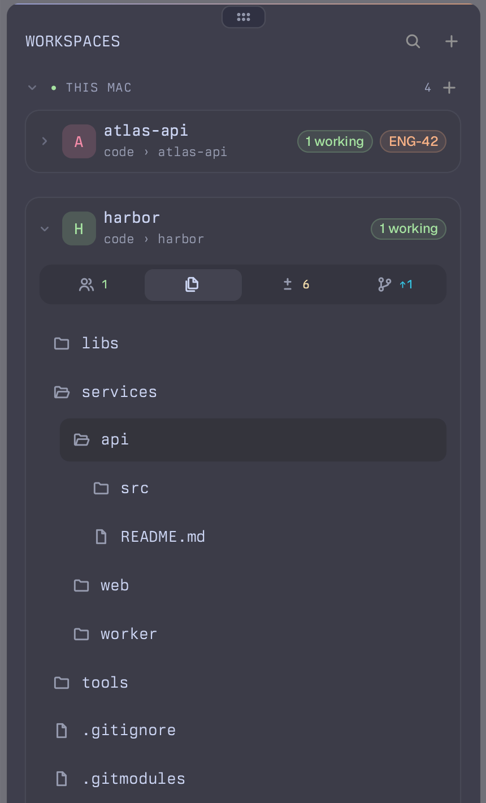
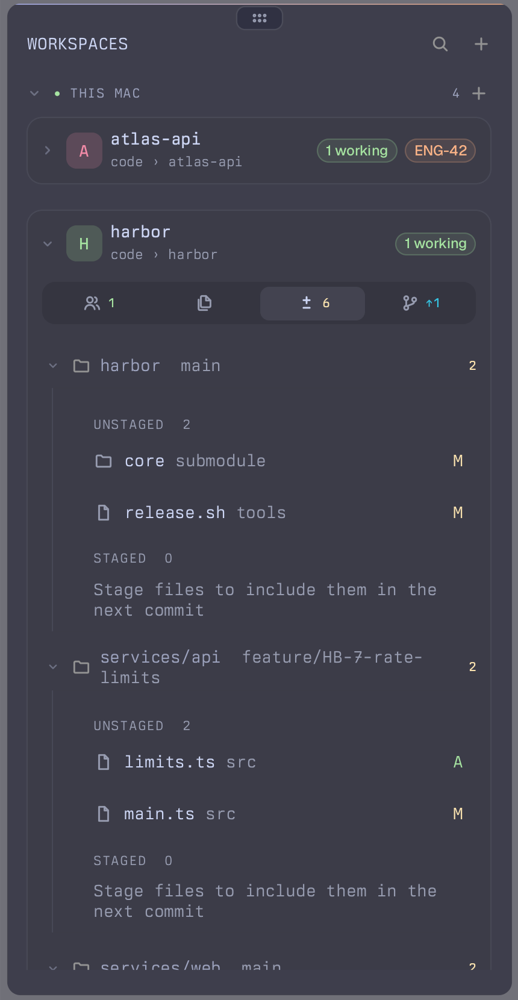
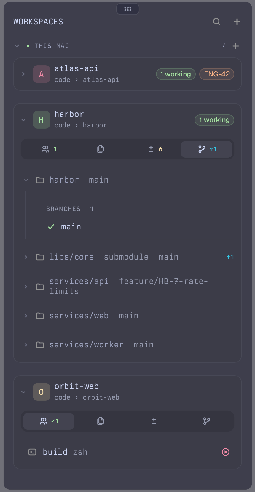
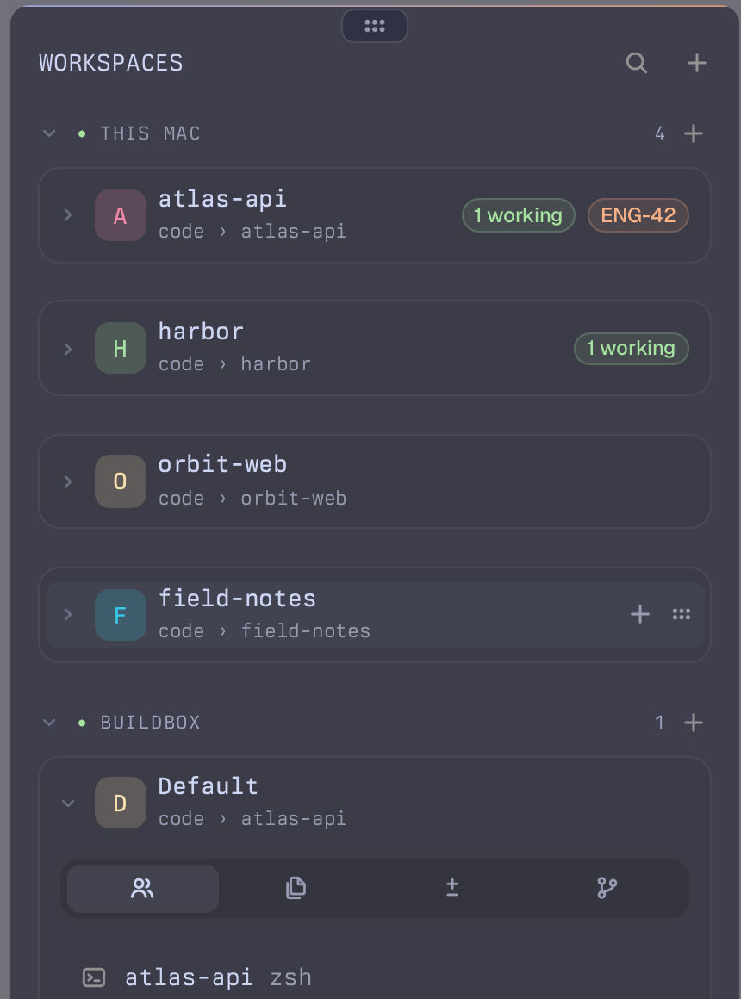

# Tern plugins

Plugins for [Tern](https://stencil.so/tern).

| Plugin | What it does |
| --- | --- |
| [Kai](kai) | A workspaces sidebar: every session as a card with its agents, files, git changes and branches, plus live agent state |


<table>
  <tr>
    <td align="center"><br><b>Agents</b><br>Live state per pane: working, running, failed</td>
    <td align="center"><br><b>Changes</b><br>Unstaged and staged files, stage from the menu</td>
    <td align="center"><br><b>Files</b><br>The workspace folder as a tree</td>
  </tr>
  <tr>
    <td align="center"><br><b>Monorepos</b><br>Nested repos and submodules, grouped</td>
    <td align="center"><br><b>Refs</b><br>Branches per repo, ahead and behind</td>
    <td align="center"><br><b>Hosts</b><br>One foldable section per machine</td>
  </tr>
</table>

## Install

```sh
tern plugin install github.com/Yupmoh/tern-plugins/kai
```

Add `--force` to update an installed copy.

## License

[MIT](LICENSE)
