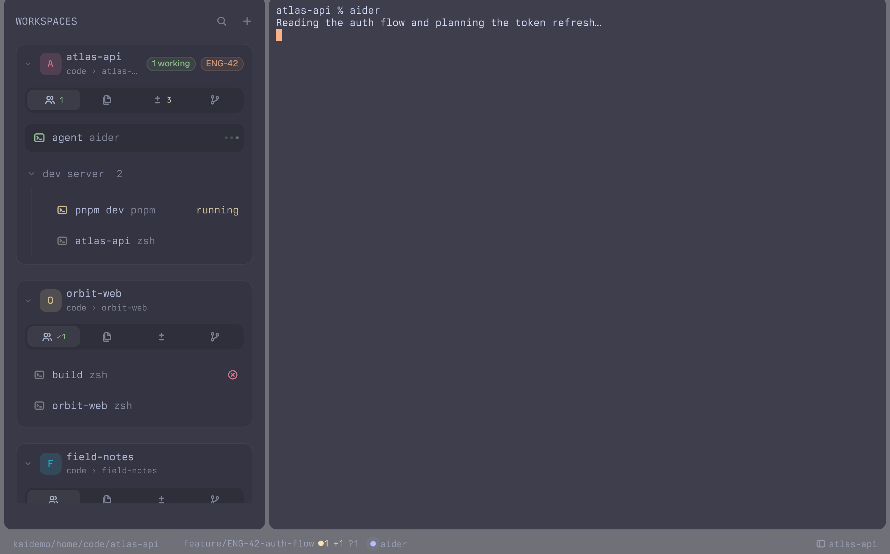
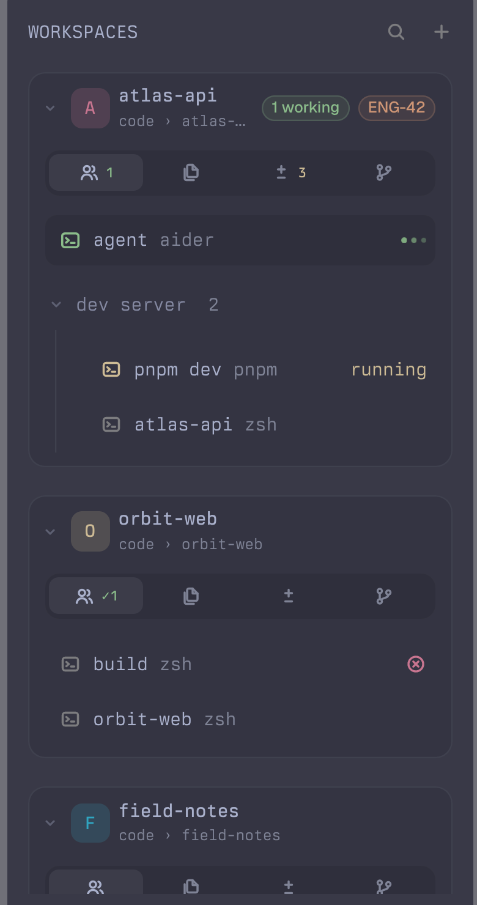
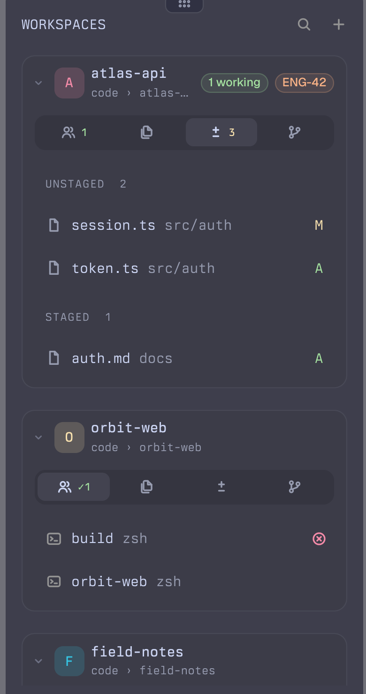

# Kai

A workspaces sidebar for [Tern](https://stencil.so/tern). Every Tern session is a workspace card. Under each card you switch between its agents (tabs and panes), its files, its git changes and its branches. Agent state is live, anything that finished while you were away is marked, and everything can be reordered.



## Install

```sh
tern plugin install github.com/Yupmoh/tern-plugins/kai
```

Update later with the same command plus `--force`. Press `⌘\` to show or hide the sidebar.

Optional: PR badges need the [GitHub CLI](https://cli.github.com) (`gh`) signed in. Linear ticket badges ask once for your workspace slug.

## What you see

<p>
  
  
</p>

- **Workspace card:** a colored tile (the initial, or an icon you pick), the name, a short path, Linear ticket and PR badges, and working or waiting pills. A folded card shows a one-line summary (`3 tabs · 1 working · main`). Cards only fold when you fold them.
- **Agents:** one row per pane. A single-pane tab is one row; a split tab is a foldable group. A spinner while an agent works, a pulsing dot while it waits for you, ✓ when it finished while you were elsewhere, ✗ when a command failed. The agent's last reply shows as a second line, and the model is in the tooltip.
- **Files:** the workspace folder as a tree, folders first and `.git` hidden. Click a folder to expand it, or a file to open it in Tern.
- **Changes:** unstaged files (conflicts first) and staged files, each with its status letter. Right-click for Stage, Unstage, Open and Copy Path.
- **Refs:** local branches (✓ current, ↑↓ against upstream) and remotes. Right-click a branch to check it out.

## Using it

| Do | How |
| --- | --- |
| Show or hide the sidebar | `⌘\`, or click the workspace name in the status bar |
| Switch workspace | Click its card, or `⌘⌃1` to `⌘⌃9` by position |
| Jump to what needs you | `⌘⌃0`: a waiting agent first, then a failed command, then a finished agent. The status bar shows "N waiting" while agents wait |
| Focus a pane | Click its row |
| Filter | The search icon in the header, or `⌘⌃F`. Matches workspace, tab and pane names |
| Reorder | Hover a row, click its grip (or right-click → Move…), then click a "Move here" slot. Workspace order is kept; tabs and panes move in Tern itself |
| New tab or close | Hover a row: `+` on a workspace, `✕` on tabs and panes |
| Park a workspace | Right-click → Move to Ice Box. The box icon in the header shows or hides parked ones |
| Icon and color | Right-click a workspace → Set Icon…, Set Color… |
| Sounds | Right-click the WORKSPACES header → Turn Sounds On. Off by default; toasts always show |
| Ask Carly | "Open my atlas-api workspace", or give a folder path to create one |

Right-click menus also cover rename, lock, tab colors, splits, moving panes to other tabs or workspaces, interrupting or stopping agents, Copy Path and Reveal in Finder.

## How it works

- `window.luau` holds the model (sessions, tabs, panes, agent state, git, files), the per-tab panel, clicks, menus and commands. `view.luau` turns the model into Tern-native nodes. `styles.css` only sets spacing and shading, scoped to `kai.*` roles.
- Tern has no window-level sidebar API, so each tab gets its own canvas pane as a full-height left column. A tab that is already split is rebuilt around it, keeping its shape and ratios. Only the visible tab's panel redraws; the others catch up when shown.
- Tern gives each callback a 50 ms budget. Drawing runs in its own timer callback, git reads are asynchronous, and folder listings run in the background with a 10 s cache.
- Fold state, views, workspace order, icons, colors, the Ice Box, unseen marks and settings live in Tern's plugin storage.

**Limits:** Tern canvases only receive clicks, so reordering is pick-then-place rather than drag. The thin scrollbar style applies to all canvases, so other plugins' canvases get it too.

## Developing

```sh
git clone https://github.com/Yupmoh/tern-plugins
tern plugin link tern-plugins/kai
```

A linked plugin runs from your clone, so edits go live with `tern plugin reload`. `tern plugin types kai` writes `tern.d.luau` for luau-lsp.

## License

[MIT](../LICENSE)
